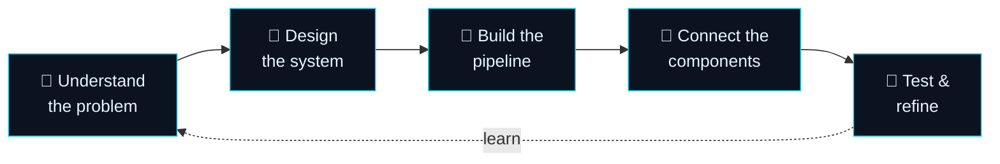

<!-- ═══════════════════════════  HEADER  ═══════════════════════════ -->
<p align="center">
  
</p>

<p align="center">
  <a href="https://aasveer-portfolio.pages.dev">
    
  </a>
</p>

<p align="center">
  <a href="https://aasveer-portfolio.pages.dev"></a>
  <a href="https://www.linkedin.com/in/aasveer-singh"></a>
  <a href="mailto:singhaasveer@gmail.com"></a>
</p>

<p align="center">
  
  
  
</p>

---

## 🧬 `whoami`

<table>
<tr>
<td width="58%" valign="top">

Hey, I'm **Aasveer** 👋, a Computer Science & Engineering (AI/ML) student who enjoys building **practical AI applications**: systems where intelligent models, backend engineering, data processing and usable interfaces actually fit together.

I care less about a model's demo and more about the **whole system** around it:

- 🔎 **Retrieve before you generate.** Answers should rest on real source material.
- 🧱 **Every stage is checkable.** OCR, NLP, retrieval and generation stay separate.
- 🛟 **Design for the failure case.** No API key? The app still works and says so.
- 🎯 **Built for a person.** If nobody can use it, it isn't finished.

</td>
<td width="42%" valign="top">

```python
class Aasveer:
    role     = "AI/ML Engineer"
    location = "Amritsar, India 🇮🇳"
    degree   = "B.Tech CSE (AI/ML)"
    college  = "Amritsar Group of Colleges"

    focus = [
        "Generative AI", "LLMs", "RAG",
        "NLP", "Recommendation Systems",
        "OCR & Document Intelligence",
    ]

    def philosophy(self):
        return ("A model is only one part "
                "of a system. The work is "
                "making every part fit the "
                "person using it.")
```

</td>
</tr>
</table>

---

## ⚙️ How I build



| Stage | What it means | Seen in |
| :-- | :-- | :-- |
| 🎯 **Understand** | Work out what the person actually needs before picking tools | **GiftBro AI**: the real risk was a model inventing gifts, so ranking real items became the core |
| 📐 **Design** | Decide the parts, their jobs, and how data moves | **PennyBloom**: one Python core holds every rule, so the CLI and web app can't disagree |
| 🧪 **Build** | Build the main path one stage at a time | **Wingman AI**: OCR → signal analysis → profiling → retrieval, each a separate stage |
| 🔌 **Connect** | Join backend, data and UI through clear boundaries | **InterviewIQ**: an Express + Vite server proxies to FastAPI, giving the browser a single origin |
| 🔁 **Refine** | Try real inputs and plan for missing dependencies | **StudyForge AI**: without a Gemini key it shows the retrieved source text, clearly labelled |

---

## 🚀 Featured projects

> Six systems. Six different problems. One rule: **make AI actually useful, and honest about what it's doing.**

### ⚡ Quick view

| # | Project | What it solves | Core tech | Link |
| :-: | :-- | :-- | :-- | :-: |
| 01 | 📚 **StudyForge AI** | Answers grounded in a student's own PDFs, plus quizzes and planning | `RAG` `FastAPI` `Gemini` | [Repo ↗](https://github.com/akshita-sharda/STUDYFORGE-AI-) |
| 02 | 💰 **PennyBloom** | Budgets, recurring payments and reports, with one shared core | `Python` `FastAPI` `React` | [Repo ↗](https://github.com/singhaasveer-lab/PennyBloom) |
| 03 | 🎤 **InterviewIQ** | Adaptive mock interviews with AI scoring and feedback | `React` `FastAPI` `Gemini` | [Repo ↗](https://github.com/singhaasveer-lab/InterviewIQ) |
| 04 | 💬 **Wingman AI** | Turns chat screenshots into signals, briefs and reply strategies | `OCR` `NLP` `RAG` | [Repo ↗](https://github.com/singhaasveer-lab/wingman_ai) |
| 05 | 🎁 **GiftBro AI** | Ranks real gifts first, then explains them with Gemini | `Scikit-learn` `TF-IDF` `Gemini` | [Repo ↗](https://github.com/singhaasveer-lab/giftbro-ai) |
| 06 | 🎟️ **SmartQueue AI** | Live digital tokens, staff dispatch and queue analytics | `React` `TypeScript` `Vite` | [Repo ↗](https://github.com/singhaasveer-lab/smartqueue-ai) |

> 💡 *Check out the complete interactive showcase, with architectures, evidence and the AI Systems Lab, on my* [**personal portfolio website**](https://aasveer-portfolio.pages.dev).

### 🔍 Deep dive

<!-- ───────────── 01 ───────────── -->
### `01` 📚 StudyForge AI &nbsp;·&nbsp; <sub>AI-powered study platform for CS students · team project</sub>

> *Answers that stay with the source.*

Students upload their own PDFs and get **answers grounded in that material through RAG**, plus Gemini-generated **flashcards and quizzes**, study modes and planning tools. When there's no API key, a **local RAG fallback** shows the retrieved source text instead of failing.

```
PDF ─▶ page-numbered chunks ─▶ TF-IDF + cosine retrieval ─▶ Gemini answer ─▶ flashcards & quizzes
```

**🧑‍💻 My part:** RAG, study planning, quizzes, NLP, FastAPI and SQLite<br/>
**🛠️ Stack:** `Python` `FastAPI` `Next.js` `React` `RAG` `Gemini API` `SQLite` `pytest`<br/>
🔗 [**Repository**](https://github.com/akshita-sharda/STUDYFORGE-AI-)

<!-- ───────────── 02 ───────────── -->
### `02` 💰 PennyBloom &nbsp;·&nbsp; <sub>Personal finance management platform</sub>

> *One core, two interfaces, zero disagreements.*

A finance tracker with **one Python core and two interfaces**: a menu-driven CLI and a React + TypeScript web app over a thin FastAPI layer. It tracks income and expenses, monthly budgets, and recurring payments without duplicates, with monthly reports, category breakdowns and a **next-month estimate from a three-month average**. Data lives in local JSON with **atomic saves, validated CSV import/export and checksummed backups**.

```
transactions ─▶ validation ─▶ budgets & recurring rules ─▶ reports & trends ─▶ atomic JSON storage
```

**🛠️ Stack:** `Python` `FastAPI` `React` `TypeScript` `Vite` `Tailwind CSS` `Recharts` `Motion`<br/>
🔗 [**Repository**](https://github.com/singhaasveer-lab/PennyBloom)

<!-- ───────────── 03 ───────────── -->
### `03` 🎤 InterviewIQ &nbsp;·&nbsp; <sub>AI-powered mock interview platform</sub>

> *Practice that talks back.*

A full-stack mock interview platform for **technical, behavioural (STAR) and system-design** interviews. Gemini generates **adaptive MCQ and open-ended questions**, and an AI evaluation step scores every answer on **technical depth, communication clarity, problem solving and confidence**, followed by strengths, weak spots and a prep roadmap. It also includes a Resume ATS scanner, a job description analyser, a keyword-ranked knowledge base, a voice interview room and a live coding sandbox.

```
role & skills ─▶ Gemini questions ─▶ answers ─▶ AI evaluation ─▶ feedback & analytics
```

**🛠️ Stack:** `React 19` `TypeScript` `Tailwind CSS` `Python` `FastAPI` `SQLAlchemy` `SQLite` `JWT` `Gemini API` `Vite` `Express`<br/>
🔗 [**Repository**](https://github.com/singhaasveer-lab/InterviewIQ)

<!-- ───────────── 04 ───────────── -->
### `04` 💬 Wingman AI &nbsp;·&nbsp; <sub>Conversation intelligence platform (RAG + NLP)</sub>

> *From a screenshot to a decision brief.*

Reads **chat screenshots with OCR** and runs a **multi-stage pipeline**: NLP signal analysis (warmth, reciprocity, engagement), "Conversation DNA" profiling, **local RAG retrieval** with TF-IDF and cosine similarity, a decision brief and reply strategies. Served through a FastAPI backend with a Streamlit interface and SQLite persistence.

```
screenshot ─▶ OCR ─▶ NLP signals ─▶ TF-IDF retrieval ─▶ decision brief ─▶ reply strategies
```

**🧑‍💻 My part:** backend, local RAG and NLP, OCR, Reply Lab and Dating Tips<br/>
**🛠️ Stack:** `Python` `FastAPI` `Streamlit` `OCR` `NLP` `RAG` `TF-IDF` `Cosine Similarity` `SQLite`<br/>
🔗 [**Repository**](https://github.com/singhaasveer-lab/wingman_ai)

<!-- ───────────── 05 ───────────── -->
### `05` 🎁 GiftBro AI &nbsp;·&nbsp; <sub>Hybrid ML + Generative AI gift recommender</sub>

> *Ranking first, generating second.*

A recommender that **ranks real catalogue items before any generation happens**. Candidates are filtered and scored with **TF-IDF, cosine similarity and weighted scoring** against the recipient's relationship, occasion, interests, personality, budget and things to avoid. **Gemini** then explains why each gift fits, but it **can never invent a product**.

```
catalogue ─▶ filters ─▶ TF-IDF + signals ─▶ weighted ranking ─▶ Gemini explanation
```

**🛠️ Stack:** `Python` `Scikit-learn` `Pandas` `TF-IDF` `FastAPI` `Streamlit` `Gemini API` `SQLite`<br/>
🔗 [**Repository**](https://github.com/singhaasveer-lab/giftbro-ai)

<!-- ───────────── 06 ───────────── -->
### `06` 🎟️ SmartQueue AI &nbsp;·&nbsp; <sub>Intelligent queue management & analytics</sub>

> *No more standing in line, guessing.*

Replaces physical lines with **real-time digital tokens**. Visitors pick a service, join a standard or priority queue, and follow their **live position and estimated wait**. Staff open and close counters, call the next token and dispatch people across counters, while **rule-based congestion insights** and analytics cover waiting and service times, throughput, priority share and no-shows, with CSV/JSON export.

```
digital token ─▶ queue state ─▶ rule engine ─▶ staff dispatch ─▶ counters & analytics
```

**🛠️ Stack:** `React` `TypeScript` `Vite` `Tailwind CSS` `React Context API` `Lucide React`<br/>
🔗 [**Repository**](https://github.com/singhaasveer-lab/smartqueue-ai)

<br/>

<p align="center">
  <a href="https://aasveer-portfolio.pages.dev"></a>
</p>

---

## 🧠 Where my skills meet real builds

| Capability | Where it's built |
| :-- | :-- |
| 🔎 **RAG & retrieval** | StudyForge AI · Wingman AI · InterviewIQ |
| ✨ **Generative AI & LLM apps** | InterviewIQ · GiftBro AI · StudyForge AI |
| 🗣️ **NLP** | Wingman AI · StudyForge AI |
| 🎯 **Recommendation engines** | GiftBro AI |
| 📄 **OCR & document intelligence** | Wingman AI |
| 🔌 **Backend & API engineering** | InterviewIQ · Wingman AI · GiftBro AI · StudyForge AI · PennyBloom |
| 📊 **Data & analytics** | PennyBloom · SmartQueue AI |

---

## 🧰 Tech arsenal

<p align="center">
  <br/>
  <br/>
  
</p>

<details>
<summary><b>📂 Full skill list (click to expand)</b></summary>
<br/>

| Area | Skills |
| :-- | :-- |
| **Languages** | Python · SQL · C/C++ · JavaScript · TypeScript |
| **AI / ML** | Machine Learning · Scikit-learn · Feature Engineering · Recommendation Systems · Forecasting (Prophet) |
| **Generative AI & NLP** | LLMs · Generative AI · RAG · Prompt Engineering · NLP · TF-IDF · Cosine Similarity · Information Retrieval · AI Output Evaluation |
| **AI models & platforms** | OpenAI API · Google Gemini API (GenAI SDK) · Anthropic Claude API · Claude Code · Hybrid ML + LLM pipelines |
| **Backend & APIs** | FastAPI · Flask · Streamlit · REST APIs · JWT Authentication · SQLAlchemy |
| **Data & databases** | Pandas · NumPy · Matplotlib · Data Analysis · OCR · PDF Parsing (PyPDF2) · SQLite · MySQL · PostgreSQL |
| **Frontend** | React · Next.js · TypeScript · Vite · Tailwind CSS · HTML · CSS |
| **Tools & concepts** | Git · GitHub · Jupyter · Google Colab · OOP · DBMS · Data Structures · Problem Solving |

</details>

---

## 🏅 Credentials

<details>
<summary><b>🎓 12 certifications across 6 academies (click to expand)</b></summary>
<br/>

| Track | Certification | Issuer |
| :-- | :-- | :-- |
| ✨ **Generative AI & LLMs** | Introduction to Large Language Models | IBM SkillsBuild |
| | Introduction to Generative AI | Google Cloud Skills Boost |
| | Introduction to Modern AI | Cisco |
| | AI Practitioner: Ready to Use AI | IBM SkillsBuild |
| 🤖 **Building with Claude** | Claude Code 101 | Anthropic Claude Academy |
| | Building with the Claude API | Anthropic Claude Academy |
| | Claude Platform 101 | Anthropic Claude Academy |
| | Claude 101 | Anthropic Claude Academy |
| 📊 **ML & data** | Machine Learning | IBM SkillsBuild |
| | Azure Database for PostgreSQL: Vector Search | Microsoft Learn |
| 🧭 **Prompting & thinking** | Introduction to Prompt Engineering with GitHub | Microsoft Learn |
| | Critical Thinking in the AI Era | HP LIFE |

</details>

---

## 📊 GitHub analytics & top languages

<p align="center">
  
  
</p>

<p align="center">
  
</p>

<p align="center">
  
</p>

<p align="center">
  
</p>

<!-- 🐍 Contribution snake: works after you add the workflow in .github/workflows/snake.yml (see the note in chat) -->
<p align="center">
  <picture>
    <source media="(prefers-color-scheme: dark)" srcset="https://raw.githubusercontent.com/singhaasveer-lab/singhaasveer-lab/output/github-snake-dark.svg"/>
    
  </picture>
</p>

---

## 🔭 Right now

```diff
+ Going deeper into RAG, LLM evaluation and multi-stage AI pipelines
+ Building AI apps that are reliable, explainable and actually used
+ Sharpening full-stack architecture: clean APIs, clear boundaries
+ Open to AI/ML engineering opportunities and interesting collaborations
```

## 🌱 Beyond the code

<p>
  🏀 Basketball &nbsp;·&nbsp; 🥊 Boxing &nbsp;·&nbsp; 📖 Novels & folklore &nbsp;·&nbsp; 🎌 Anime &nbsp;·&nbsp; 🎧 Music &nbsp;·&nbsp; ✈️ Travel
</p>

---

<h2 align="center">🤝 Let's connect and build something intelligent!</h2>

<p align="center">
  I'm always up for conversations about <b>AI products, RAG and LLM systems, ML pipelines, full-stack apps</b><br/>
  and <i>ideas that might actually work</i>.
</p>

<p align="center">
  <a href="https://www.linkedin.com/in/aasveer-singh"></a>
  <a href="https://aasveer-portfolio.pages.dev"></a>
  <a href="mailto:singhaasveer@gmail.com"></a>
  <a href="https://github.com/singhaasveer-lab?tab=repositories"></a>
</p>

<p align="center">
  
</p>

<p align="center">
  
</p>
